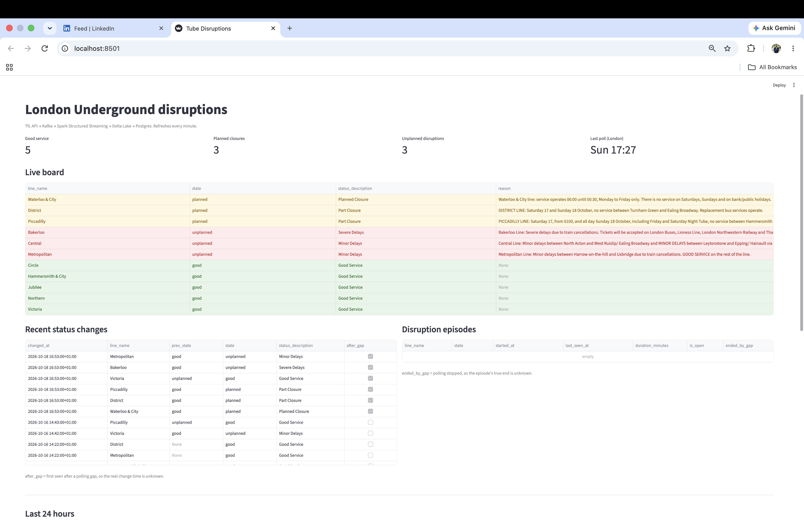
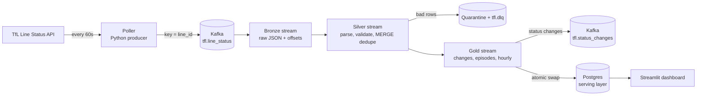
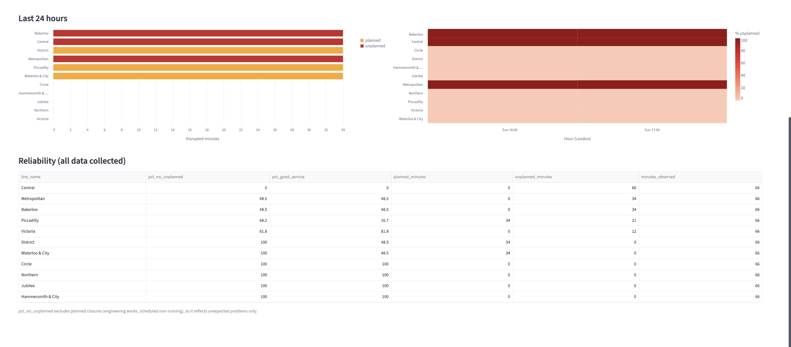

# TfL Disruptions Lakehouse

[](https://github.com/Daudsaid/tfl-disruptions-lakehouse/actions/workflows/ci.yml)

A real-time streaming pipeline that tracks London Underground line status every minute, turns raw snapshots into **status changes** and **disruption episodes**, and serves them on a live dashboard.

Runs entirely locally with Docker: **Kafka → Spark Structured Streaming → Delta Lake (bronze/silver/gold) → Postgres → Streamlit**.



---

## Architecture



| Layer | Table | Grain | How it's written |
|---|---|---|---|
| Bronze | `bronze/line_status` | One row per Kafka message | Append, raw JSON kept untouched with partition/offset |
| Silver | `silver/line_status` | One row per line, per poll, per status | `foreachBatch` + Delta `MERGE` on `(event_id, status_position)` |
| Gold | `current_status` | One row per line | Rebuilt from silver each batch |
| Gold | `status_changes` | One row per state change | Incremental (`left_anti` join), published to Kafka |
| Gold | `disruption_episodes` | One row per continuous disruption | Gaps-and-islands over silver |
| Gold | `disruptions_by_hour` | Line × hour | Planned vs unplanned minutes |

## What it answers

- Which lines are disrupted **right now**, and is it **planned** (engineering works) or **unplanned** (signal failures, cancellations)?
- When did each line's status **change**?
- How long did each disruption **last**?
- Which lines are most reliable once planned closures are excluded?



## Tech stack

| Area | Tools |
|---|---|
| Streaming | Apache Kafka (KRaft), Spark Structured Streaming 4.0 |
| Storage | Delta Lake 4.0 (medallion architecture) |
| Serving | PostgreSQL 17, Streamlit, Altair |
| Language | Python 3.12, PySpark |
| Infra | Docker Compose (OrbStack on Apple Silicon) |
| Quality | pytest + chispa (Spark DataFrame tests), ruff, GitHub Actions |
| Packaging | uv with dependency groups (`spark`, `dashboard`, `dev`) |

---

## Design decisions and trade-offs

**One event per line per poll, keyed by `line_id`.**
All events for a line land in the same Kafka partition, so they stay in order, which change detection depends on.

**Deterministic `event_id` + idempotent writes instead of "exactly-once".**
Polls are aligned to whole minutes, so a retry produces the same `event_id`. The producer is idempotent (`acks=all`), and silver `MERGE`s on the event key, so replays after a crash never create duplicates. End-to-end exactly-once is hard; at-least-once delivery plus idempotent writes gives the same result.

**Bronze stores the raw message, untouched.**
If parsing logic has a bug, silver can be rebuilt from bronze without re-polling TfL.

**Bad data is quarantined, never dropped.**
Rows that fail validation (malformed JSON, missing statuses, out-of-range severity, unparseable timestamps) go to a quarantine Delta table and a `tfl.dlq` topic, with their Kafka offset for tracing.

**Planned vs unplanned disruptions are separated.**
The real data showed weekend engineering works and scheduled non-running (e.g. Waterloo & City on Sundays) inflating "disruption" numbers. Gold classifies TfL severity codes into `good`, `planned` and `unplanned`, and the dashboard reports reliability as *% of time without unplanned disruption*. On one weekend sample, Piccadilly scored 16.7% "good service" but 68.2% without unplanned disruption; the difference was entirely planned works.

**Polling gaps are never filled in.**
If the poller stops (e.g. laptop asleep), a gap longer than 5 minutes ends a disruption episode (`ended_by_gap = true`), and a status change first seen after a gap is flagged `after_gap = true`. The pipeline reports what it observed rather than guessing.

**Gold is rebuilt from silver on every micro-batch.**
At ~16,000 rows/day this takes seconds and is always correct, even with late data. At larger scale this would move to incremental windowed processing.

**Postgres is a serving copy, refreshed by atomic table swap.**
Delta is the source of truth. Each refresh writes to a staging table, then swaps it in with `DROP` + `RENAME` inside one transaction, so the dashboard never sees an empty or half-written table.

**Batch volume, streaming architecture.**
~11 events a minute doesn't *need* streaming. It's built this way to demonstrate Kafka and Structured Streaming patterns (checkpoints, micro-batches, idempotent sinks, DLQs) that matter at higher volumes.

## Things I learned the hard way

- **Spark 4 enables ANSI mode by default.** A unit test showed that `to_timestamp("yesterday")` throws instead of returning null, which would have crashed the silver stream on a single bad record. Switching to `try_to_timestamp` means bad timestamps are quarantined instead.
- **Non-atomic serving refreshes cause flickering.** The dashboard intermittently showed empty tables because the refresh did `TRUNCATE` then `INSERT`. Fixed with the staging-table swap above.
- **Stream checkpoints are tied to the broker.** After the Kafka container was recreated, offsets restarted at 0 while the bronze checkpoint remembered old offsets. No data was lost (bronze had already persisted every event); resetting the bronze checkpoint re-aligned it, and silver's `MERGE` absorbed any overlap.
- **Snapshot comparisons across gaps lie.** Comparing the first poll after a two-day gap with the last poll before it produced fake "changes". That's why `after_gap` exists.

---

## Running it

**Requirements:** Docker (Docker Desktop or OrbStack), about 4 GB of free RAM.

```bash
git clone https://github.com/Daudsaid/tfl-disruptions-lakehouse.git
cd tfl-disruptions-lakehouse
cp .env.example .env            # set POSTGRES_PASSWORD; TFL_APP_KEY is optional
docker compose build
docker compose up -d
```

The first build downloads Spark and takes a few minutes. Silver and gold may restart a few times on the very first run until the upstream Delta tables exist.

| URL | What |
|---|---|
| http://localhost:8501 | Streamlit dashboard |
| http://localhost:8080 | Kafka UI (topics, messages, consumer lag) |
| http://localhost:4040 / 4041 / 4042 | Spark UIs for bronze / silver / gold |

Stop with `docker compose stop` (keeps data) and resume with `docker compose start`.

## Tests

The transforms are pure functions (DataFrame in, DataFrame out), tested with small hand-built DataFrames:

```bash
# Inside the Spark container (no local Java needed)
docker compose run --rm --no-deps -v ./tests:/app/tests spark-silver pytest -v

# Poller tests only, on the host
uv run pytest -v
```

Covered: event construction, JSON validation and quarantine, status explosion and dedupe, planned/unplanned precedence, gaps-and-islands episodes, gap splitting, and `after_gap` flagging. CI runs ruff and the full suite (including Spark) on every push, and builds the Docker images.

## Project structure

```
├── src/tfl/
│   ├── common/        # config (pydantic-settings), Spark session
│   ├── producer/      # TfL poller -> Kafka
│   └── streams/       # bronze.py, silver.py, gold.py
├── dashboard/         # Streamlit app
├── docker/            # Dockerfiles: poller, spark, dashboard
├── tests/             # pytest + chispa
├── docker-compose.yml
└── .github/workflows/ci.yml
```


---

Data: [Transport for London Unified API](https://api.tfl.gov.uk/). Powered by TfL Open Data.
